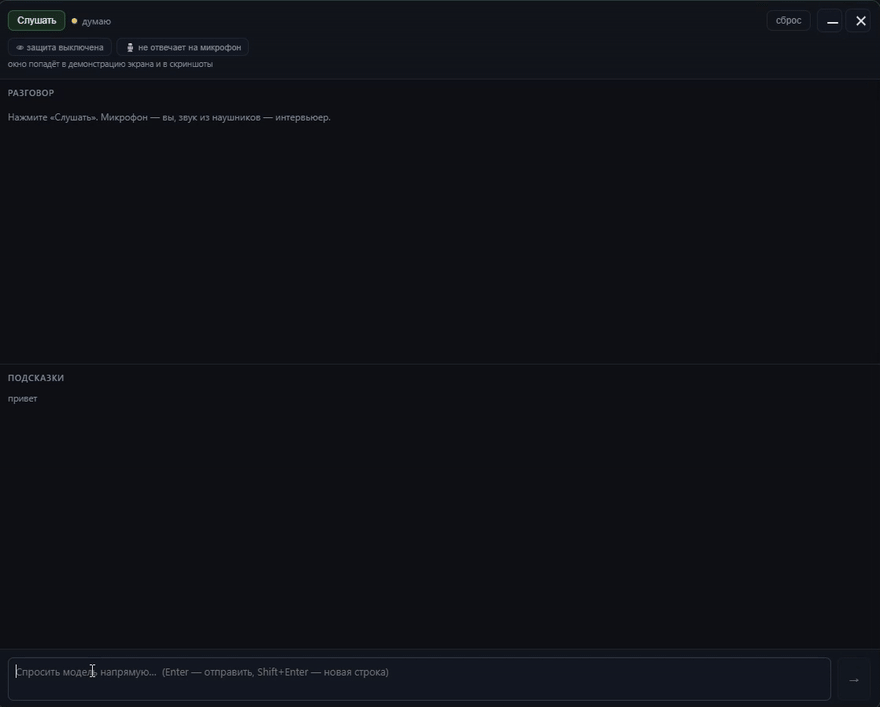

# Answerline

<p align="center">
  
</p>

<p align="center">
  
</p>

<p align="center">
  <a href="#что-это">Что это</a> · <a href="#быстрый-старт">Быстрый старт</a> · <a href="#свой-rag-корпус">Свой RAG</a> · <a href="#горячие-клавиши">Клавиши</a>
</p>

<p align="center">
  <a href="https://github.com/HerpBac9/answerline/stargazers"></a>
  
  
  
  
</p>

## Что это

ИИ-помощник, который работает на вашем компьютере. Он слушает разговор, а
микрофоном улавливает ваши уточнения — и отвечает **по вашему
RAG-корпусу**. В режиме по умолчанию LM Studio эмбеддинги, поиск и генерация
выполняются локально. Необязательный режим ChatGPT IDE Bridge использует облачную
генерацию, передавая в ChatGPT Web вопрос, транскрипт и выбранные RAG-материалы.

На вопрос из наушников прилетает ответ в оверлей поверх окон. Он **не
озвучивается** — этого никто не услышит.

- **Учёба.** Корпус — ваши конспекты и разобранные задачи. Ответ опирается на них,
  а не на догадки модели.
- **Собеседование.** Наушники ловят вопросы интервьюера.
- **Рабочий созвон.** Второй участник спрашивает про то, что обсуждали часом
  раньше, — и это уже есть в корпусе.

Разделение говорящих физическое: системный аудиоканал — это тот, кого вы
слушаете, микрофон — это вы. Диаризация не нужна.

## Быстрый старт

```bash
npm install
npm run doctor     # проверяет LM Studio, Qdrant и пути — запустите первым
npm run dev
```

**Что нужно поставить заранее:**

| Что | Зачем |
|---|---|
| [LM Studio](https://lmstudio.ai) с загруженной моделью и запущенным сервером | генерация ответов и эмбеддинги |
| [Qdrant](https://qdrant.tech) | векторный поиск по корпусу |
| Собранный [whisper.cpp](https://github.com/ggml-org/whisper.cpp) и модель | распознавание речи |
| Windows 10+ или macOS 14.4+ | платформа |
| Наушники | без них собеседника слышно в ваш канал |

Пути к whisper.cpp и модели, коллекция Qdrant и модель эмбеддингов задаются в
`config.json`. Он создаётся при первом запуске: `%APPDATA%\answerline\config.json`
в Windows, `~/Library/Application Support/answerline/config.json` в macOS.
Почти все проблемы при первом старте — это неверный путь в конфиге, и `doctor`
показывает их сразу.

> **Длина контекста в LM Studio держите на 8192–16384.** На видеокарте 8 ГБ
> максимальный контекст вытесняет KV-кэш в оперативную память, и скорость падает
> с ~56 токенов/с до 2–12. Подробности и таблица замеров — в
> [docs/performance.md](docs/performance.md).

На macOS при первом запуске разрешите микрофон и **System Audio Recording** в
System Settings → Privacy & Security. Чтобы проверить всё в одиночку, скопируйте
`.env.example` в `.env` и поставьте `ANSWERLINE_ANSWER_FROM_MIC=1` — тогда вопрос
в микрофон тоже вызывает ответ.

## ChatGPT IDE Bridge (альтернативная генерация)

Если запущен **ChatGPT IDE Bridge** из отдельного проекта `notion`
(`127.0.0.1:17841`), Answerline может использовать его вместо локальной LLM.
Это **OpenAI Responses API**, не `/v1/chat/completions`.

В `.env` установите (из каталога Answerline):

```dotenv
LLM_PROVIDER=bridge
LLM_BASE_URL=http://127.0.0.1:17841
LLM_MODEL=chatgpt-web/gpt-6-sol
LLM_REASONING_EFFORT=low
LLM_PROJECT_URL=https://chatgpt.com/g/g-p-6acbc986ba2c8191bdbb04545b30a1ae-answerline/project
LLM_PROJECT_PROMPT_MODE=project
```

**Одна сессия приложения = один новый чат внутри ChatGPT Project `answerline`.**
Ссылка может вести на домашнюю страницу проекта (`/project`) или на любой
чат внутри него (`/c/...`): старый чат по ссылке не используется. При запуске
Answerline создаёт новый случайный `x-session-id` только в оперативной памяти.
Первый Send открывает проект и создаёт новый чат; все следующие вопросы до
закрытия приложения идут в этот же чат. После закрытия и повторного запуска
создаётся другой `x-session-id`, поэтому начинается новый чат. Кнопка «Сброс»
также создаёт новый чат. Bridge сохраняет соответствие ID сессии и ChatGPT URL
со своей стороны — возвращать реальный ID чата в Answerline не требуется.

При `LLM_PROJECT_PROMPT_MODE=project` Answerline **не отправляет длинный
системный промпт повторно**: роль, стиль и правила ответа задаются в поле
«Инструкции» в настройках самого проекта ChatGPT. Вставьте туда текст из
[`prompts/chatgptProjectInstructions.md`](prompts/chatgptProjectInstructions.md)
**до использования приложения** — сейчас автоматически изменять настройки
проекта Bridge не умеет. Инструкции требуют один связный абзац из 5–7
предложений без списков, таблиц и Markdown, ясный язык с конкретной технической
сутью и запрет на неподтверждённые утверждения о личном production-опыте.

Для GPT-6 в активной `.env` выставлено `RAG_GENERAL_TOP_K=0` и
`RAG_PERSONAL_TOP_K=1`: общий теоретический поиск отключён, один наиболее
подходящий личный фрагмент из Qdrant добавляется только при прохождении порога
релевантности. При отсутствии подходящего личного факта блок
`<personal_experience>` отсутствует и GPT-6 отвечает на теорию самостоятельно.
Сама база общих знаний остаётся нетронутой; для слабой локальной LLM можно
вновь включить общий поиск. В каждом вопросе отправляются вопрос, транскрипт
и при наличии личный RAG-фрагмент вместе с короткой защитной инструкцией.
Для прежнего режима (полный промпт внутри каждого запроса) установите
`LLM_PROJECT_PROMPT_MODE=inline`.

`npm run doctor` проверит `/healthz` и `/bridge/settings` **без отправки вопроса**.
Bridge использует только **GPT-6**: без явного `reasoning.effort` выбирает Extra High,
но Answerline отправляет **Low / GPT-6 Instant** для минимизации задержки.
Допустимы `low`, `medium`, `high`, `xhigh` в `LLM_REASONING_EFFORT`;
`none` недоступен в ChatGPT Web (для быстрого ответа используй `low`).
Дополнительно Answerline передаёт `tools: []`, `tool_choice: none` и
`client_metadata.x-bridge-no-local=true`. В обновлённом Notion Bridge этот
флаг гарантирует отсутствие выбранного `@Local` даже при обычном запуске
Bridge с включённым Local для IDE: иначе запрос не будет отправлен.
`x-session-id` сохраняет веб-чат между вопросами; кнопка «сброс» создаёт новый
идентификатор диалога. После первого успешного ответа обновлённый Bridge
переиспользует подтверждённый выбор GPT-6 Instant для того же сохранённого
браузерного чата, если вкладка и режим не менялись: открывать меню заново
не требуется. При сомнениях выбор повторяется через меню.
Ответы приходят потоковыми событиями Responses SSE.

**Приватность:** вопросы, транскрипт и выбранные RAG-материалы отправляются в
ChatGPT Web. Захват аудио, Whisper, Qdrant и эмбеддинги остаются локальными.
Содержимое локальной RAG-базы целиком не загружается: передаётся только
retrieved context конкретного вопроса. Этот режим не является полностью офлайн.

**LM Studio всё ещё нужен для эмбеддингов**, а Qdrant — для поиска.
Убедитесь, что Qdrant доступен по адресу из `QDRANT_URL` (по умолчанию
`127.0.0.1:6333`). Если поиск недоступен, обычный режим вопросов намеренно
не вызывает LLM и сообщает ошибку RAG.

Возврат к полностью локальной генерации:

```dotenv
LLM_PROVIDER=lmstudio
LLM_BASE_URL=http://127.0.0.1:1234
LLM_MODEL=auto
```

После изменения `.env` перезапустите Answerline. Для полного теста
реального embedding → Qdrant → Bridge → SSE (отправляет выбранные RAG-ответы
в ChatGPT Web) используйте:

```powershell
npm.cmd run answer:probe -- --dry-run --question "Что такое self-attention?"
npm.cmd run answer:probe -- --question "Что такое RAG?" --question "Чем полезен гибридный поиск?"
```

Повторные `--question` идут последовательно в **одном** `x-session-id` и позволяют
сравнить первый запрос с продолжением беседы. Исходная live-проверка 2026-10-11
на **Extra High** дала первый текст примерно за 22 секунды и полный ответ
за 55 секунд. Отдельный Low-запрос через GPT-6 Instant завершился за 19 секунд
(первый текст 13 секунд); это разные вопросы, а не контролируемый бенчмарк.
Скрипты `rag:answers` и `prompt:evaluate` остаются на Chat Completions.

**Безопасность:** стандартный запуск Bridge для IDE включает `@Local` и может
автоматически подтверждать запросы инструментов. Answerline намеренно использует
частный флаг `x-bridge-no-local` поверх `tools: []` и `tool_choice: none`:
сам по себе OpenAI `tool_choice: none` **не отключает** ChatGPT-native коннектор.
Требуется обновлённая версия Notion Bridge. При необходимости отключить Local
**для всех** клиентов запускай Bridge через `npm run start:safe`.

## Свой RAG-корпус

**Без этого приложение бессмысленно: отвечать не по чему.** Папка `data/` в
репозитории пустая и не отслеживается git — наполните её сами.

Формат простой: Q&A по темам. Каждый заголовок `##` — отдельный вопрос, текст до
следующего заголовка — ответ.

```markdown
# Мой проект

## Что вы делали в проекте X?

Отвечал за интеграцию с ERP, вёл 6 релизов.

## С чем была самая сложная задача?

Реконсиляция остатков между двумя системами.
```

Проиндексировать:

```bash
npm run rag:index
# после удаления или переименования записей:
RAG_RECREATE=1 npm run rag:index
```

### Готовый корпус, чтобы начать не с нуля

В репозитории лежит открытый пример — [`examples/corpus`](examples/corpus): 13 тем
и 6149 вопросов по AI-разработке (RAG, инференс LLM, дообучение, промпты,
распределённые системы, оценка агентов, MCP, безопасность) плюс 150 задач по
Python с решениями. Ничего личного, только общая теория — его можно
индексировать как есть:

```bash
# macOS / Linux / Git Bash
cp -r examples/corpus data
# Windows cmd:  xcopy /E /I examples\corpus data

npm run rag:index
```

Свои файлы просто положите в `data/` рядом или вместо них: всё, что там лежит,
попадёт в индекс.

Что стоит помнить:

1. **Цифры, даты и названия — в файлы, а не в голову.** Локальная модель охотно
   их выдумает, если не найдёт в базе.
2. Одна тема = один подраздел, 100–400 слов.
3. Заголовки формулируйте так, как спросил бы человек, а не как названия
   разделов документа.

Файлы с личным опытом помечайте в YAML front matter строкой
`authority: internal_project` — по этому полю рантайм отбирает персональные
записи и не смешивает их с общими. Подробный формат — в
[docs/rag-index.md](docs/rag-index.md).

## Горячие клавиши

| Клавиши | Действие |
|---|---|
| `Ctrl/Cmd+Shift+\` | показать/скрыть окно |
| `Ctrl/Cmd+Shift+P` | пауза захвата |
| `Ctrl/Cmd+Shift+Enter` | отправить последнюю реплику как вопрос |
| `Esc` в поле ввода | остановить генерацию |

## Звёзды

<p align="center">
  <a href="https://star-history.com/#HerpBac9/answerline&Date">
    
  </a>
</p>

## Ещё

- Операционные команды — [`command.md`](command.md)
- Как устроен индекс — [`docs/rag-index.md`](docs/rag-index.md)
- Что не проверено — [`docs/project-status.md`](docs/project-status.md)
- Как помочь проекту — [`CONTRIBUTING.md`](CONTRIBUTING.md)

Лицензия [MIT](LICENSE) © 2026 HerpBac9.